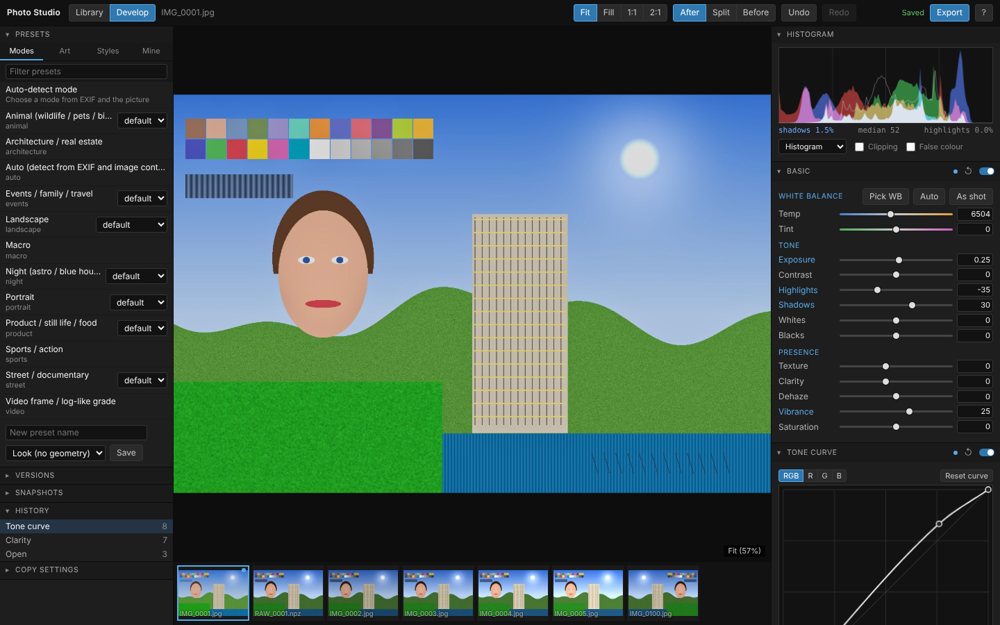
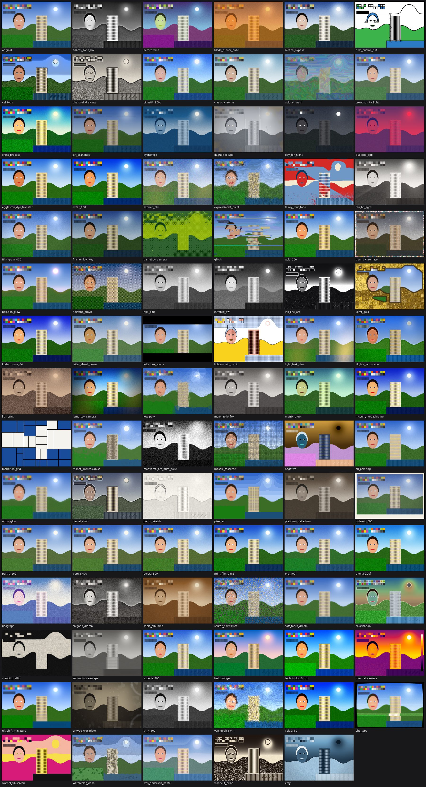

# photo-studio

[](https://github.com/yuvalkolodkingal/photo-studio/actions/workflows/tests.yml) [](LICENSE) 



A RAW and JPEG photo studio for Linux that you drive from the command line, from a local browser editor, or from
Claude Code as a skill. It is a Darktable/Lightroom replacement for one person's library, built around the Canon EOS R50
(CR3 + JPEG) and developed on Fedora. Decoding is rawpy/LibRaw, the processing is a scene-referred pipeline in numpy,
and every edit is a non-destructive sidecar next to your files.

## Install (one command)

```bash
curl -fsSL https://raw.githubusercontent.com/yuvalkolodkingal/photo-studio/main/install.sh | bash
```

This clones the repository to `~/.claude/skills/photo-studio`, creates a virtual environment there, installs the
package with the default extras, links `photo` into `~/.local/bin`, and finishes with `photo status` and the next
steps. It never runs `sudo`; when a system tool is missing it prints the Fedora command for you to run. Run it again any time to update.
It is safe to re-run.

Options, as flags after `bash -s --` or as environment variables:

| option | environment | meaning |
|---|---|---|
| `--dir DIR` | `PHOTO_STUDIO_DIR` | install somewhere else (default `~/.claude/skills/photo-studio`) |
| `--extras LIST` | `PHOTO_STUDIO_EXTRAS` | pip extras, default `serve,meta,lens,video,heif,astro,geo`; `""` for the bare core |
| `--no-link` | | do not create `~/.local/bin/photo` |
| `--uninstall` | | remove the virtual environment and the link (keeps the code, your photos and your settings) |

```bash
curl -fsSL https://raw.githubusercontent.com/yuvalkolodkingal/photo-studio/main/install.sh | bash -s -- --extras serve,meta,lens
```

Requirements: Python 3.11 or newer (Fedora: `sudo dnf install python3.12`), git (a tarball download is used if git is missing)
and a network connection for pip.

### Manual install

```bash
git clone https://github.com/yuvalkolodkingal/photo-studio ~/.claude/skills/photo-studio
cd ~/.claude/skills/photo-studio
python3.12 -m venv .venv
.venv/bin/pip install -e ".[serve,meta,lens,video,heif,astro,geo]"
.venv/bin/photo status
```

### Fedora system packages (optional, installed by you)

```bash
sudo dnf install perl-Image-ExifTool                     # full Canon CR3 maker notes, XMP
# ffmpeg with all codecs comes from RPM Fusion
sudo dnf install https://mirrors.rpmfusion.org/free/fedora/rpmfusion-free-release-$(rpm -E %fedora).noarch.rpm
sudo dnf install ffmpeg --allowerasing                   # video
sudo dnf install rclone restic                           # backup destinations
```

`photo status` tells you what is found and what is missing.

## Use it with Claude Code

The repository root is a Claude skill (`SKILL.md`). The installer puts it at `~/.claude/skills/photo-studio`, which is where
Claude Code looks. If you cloned it somewhere else, link or copy it:

```bash
ln -s ~/src/photo-studio ~/.claude/skills/photo-studio      # symlink (running install.sh from the checkout does this for you)
# or: cp -r ~/src/photo-studio ~/.claude/skills/photo-studio
```

Then ask in plain words, for example: "import my card into ~/Pictures/Library and pick the best shots", "make this one
look better, then give me a web version", "apply a Portra look to the wedding folder", "stack these five frames",
"open the editor". Claude renders, looks at the result, adjusts and renders again, and never deletes originals. The skill
documents only what the code does; limits are listed in `SKILL.md` and `references/troubleshooting.md`.

## Quickstart

```bash
photo status                                          # what works on this machine
photo --root ~/Pictures/Library import /run/media/$USER/EOS_DIGITAL --dry-run
photo --root ~/Pictures/Library import /run/media/$USER/EOS_DIGITAL --event "trip"   # verified copy, dated folders
photo --root ~/Pictures/Library analyze @last-import && photo --root ~/Pictures/Library cull @last-import
photo develop IMG_0001.CR3 --mode auto --preview 1600 --out /tmp/preview.jpg
photo develop IMG_0001.CR3 --art portra_400 --merge --version film --preview 900 --out /tmp/film.jpg
photo export IMG_0001.CR3 --preset web --out /tmp/web
photo serve ~/Pictures/Library --open                 # the browser editor
```

`photo serve` starts a Lightroom-style Library and Develop editor on `127.0.0.1` (default port 8765). It reads and writes the
same `<image>.ps.json` sidecars as the CLI, so edits you make by hand and edits Claude makes through the CLI
show up in each other. Nothing leaves your machine.

Every command accepts `--json`; `photo COMMAND --help` documents flags.

## What it does

- **Develop** a fixed 21-stage scene-referred pipeline: demosaic, profiled denoise, lens correction, white balance,
  tone equalizer, colour grading, local contrast, a single tone map, looks and effects. 139 ops; 10 shoot-type modes
  (portrait, landscape, night, street, ...) plus `auto` and `video`, with automatic detection from the Canon MakerNote and image content.
- **Looks** 88 art and film presets (film stocks, cinema grades, photographer-inspired styles, process looks such as
  cyanotype, painterly and raster art like comic, halftone, pixel art) with variants, plus Canon-like Picture Style renderings
  and a fitter that learns yours from CR3+JPEG pairs.
- **Masks and retouch** linear, radial, polygon, brush, luminosity, colour-range, parametric and AI masks (sky, subject,
  skin, face) with blend modes; heal, clone, inpaint, liquify, dodge and burn.
- **Library** SQLite catalog that is a rebuildable cache of the sidecars, ratings, flags, labels, hierarchical tags,
  smart albums, search DSL, events, galleries, contact sheets, versions and snapshots, culling with explainable suggestions.
- **Import and backup** verified import (BLAKE3), second copy, 3-2-1 backup to local drives, rclone and restic.
- **Export** presets for web, Instagram, print TIFF, archive, wallpaper and email; naming templates, ICC, watermark, borders.
- **Stacking** HDR, focus, astro, star trails, long exposure, median, panorama preview.
- **Astro stacker** `photo astro stack|finish|gui`: a Sequator-style night-sky stacker with a browser GUI. It handles
  untracked or hand-rested cameras (camera-nudge detection, star-poor city skies, frozen foreground), runs two-pass
  sigma-clipped integration on all cores within a RAM budget, and finishes with light-pollution removal, star colour,
  auto brightness, HDR, star-protected denoise and split-half validation of faint stars.
  See [docs/astro-stacking.md](docs/astro-stacking.md).
- **Video** ffmpeg-based grading with the same looks (baked LUT), per-shot grading, stabilise, denoise, stills, timelapse.

## Honest limits

Everything was written and tested against synthetic images and a fake RAW generator. Not yet verified on real files or
hardware: real Canon R50 CR3 decoding and maker notes, `calibrate picture-style`, rclone and restic transfers, NVENC,
HDR PQ video, real panoramas and astro stacks, clicking through the web UI in a browser, and the optional AI models.
Expect rough edges and report them. Full list: `references/troubleshooting.md`.

## Optional AI models and licences

No model weights or third-party data are bundled, and nothing is downloaded unless you run `photo models download NAME`.
The skill is for personal use.

| component | licence |
|---|---|
| photo-studio code | MIT (see `pyproject.toml`) |
| InsightFace weights (`faces` extra, people tagging) | non-commercial research only |
| Ultralytics YOLO (`yolo` extra, animal mask) | AGPL-3.0 |
| BM3D (`denoise` extra) | non-commercial |
| SegFormer ADE20K (sky mask) | NVIDIA research/personal licence |
| IS-Net, U2-Net, BiRefNet, Depth Anything V2 Small, MediaPipe, LaMa | Apache-2.0 or MIT upstream; check each LICENSE |

Film-stock and photographer names are descriptive labels for generic emulations, not endorsements or data from those
makers. `references/install-models-licences.md` has the full table, the extras, GPU notes and environment variables.

## Update and uninstall

```bash
curl -fsSL https://raw.githubusercontent.com/yuvalkolodkingal/photo-studio/main/install.sh | bash          # update (git pull --ff-only)
curl -fsSL https://raw.githubusercontent.com/yuvalkolodkingal/photo-studio/main/install.sh | bash -s -- --uninstall
```

Uninstall removes only the virtual environment and the `~/.local/bin/photo` link. To remove everything, delete
`~/.claude/skills/photo-studio`, `~/.cache/photostudio` and `~/.config/photostudio`. Your sidecars (`*.ps.json`, `*.xmp`)
stay next to your photos.

## Development

```bash
.venv/bin/pip install -e ".[dev]"
.venv/bin/pytest -q
.venv/bin/python scripts/gen_reference_docs.py          # refresh the generated catalogues in references/
.venv/bin/python scripts/gen_reference_docs.py --check  # fail if they are stale
.venv/bin/python scripts/check_docs.py                 # frontmatter, links, and every `photo ...` example checked against --help
```

Layout: `SKILL.md` (the skill entry), `references/` (detail loaded on demand), `photostudio/` (the package),
`presets/` and `photostudio/presets/` (YAML presets), `scripts/` (installer wrapper, doc and preset generators),
`evals/` (prompts for testing the skill), `tests/`.

## Art modes at a glance


