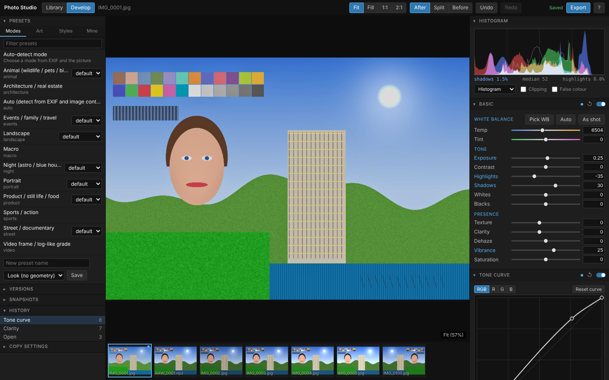
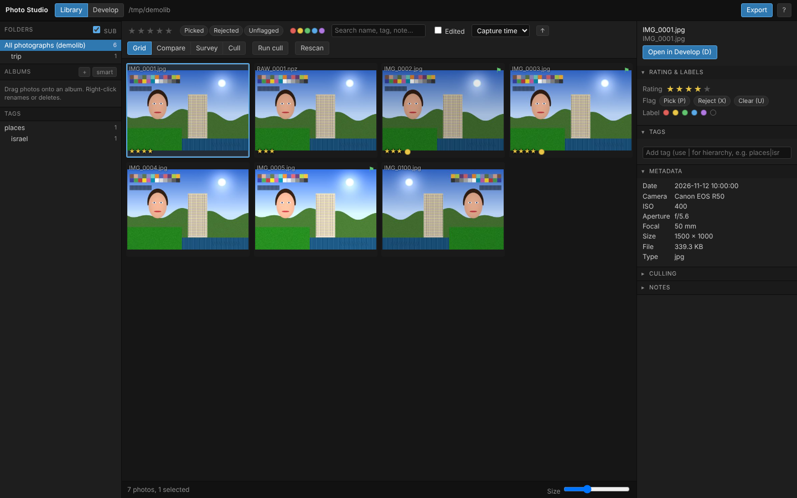

# Web editor (`photo serve`)

A local, Lightroom-style Library and Develop editor that runs in your browser and edits the
same `<image>.ps.json` sidecars as the command line. Anything you do in the browser is visible
to `photo` commands and to Claude, and anything Claude changes on disk shows up in the browser.




## Usage

```
pip install "photostudio[serve]"      # adds fastapi + uvicorn
photo serve [ROOT] [--port 8765] [--open] [--no-catalog] [--strict-port]
```

- `ROOT` is the library folder (default: `--root`, else the current directory).
- The server binds to `127.0.0.1` only. If the port is busy the next free one is used, unless
  `--strict-port` is given.
- `--open` opens the default browser. `--no-catalog` lists folders directly instead of using the
  SQLite catalog (no persisted flags or albums in that mode).
- Deep link to a photo: `http://127.0.0.1:8765/#develop:<relative/path.jpg>`.
- Fully offline: no CDN, no web fonts, no build step. The front end is vanilla ES modules in
  `photostudio/web/static/`.

## Architecture

- `photostudio/web/server.py`: FastAPI app factory, lifespan, Host/Origin guard, error handlers.
- `api_library.py`, `api_develop.py`, `api_export.py`: endpoint groups. `library.py`, `edits.py`,
  `presetops.py`, `render.py`, `jobs.py`, `state.py`, `schema.py`, `paths.py`: logic behind them.
- Rendering uses the real pipeline (`pipeline` + ops). Each browser session has latest-wins
  rendering on a thread pool: a superseded request answers `204` with `X-Superseded`. Drafts
  (small, fast) are shown while dragging, a full render follows. Responses carry an ETag.
- The op list, parameter ranges and labels come from `/api/schema`, built from the op registry, so
  the "All ops" panel always matches the engine.
- Front end: event bus and store, a `session` object (edit, save, undo, render), a canvas viewer
  (fit/fill/1:1/2:1, wheel zoom, pan, split, 1:1 tiles), tools (crop, level, white-balance pick,
  heal, mask) and panels generated from the schema.

## Features

Library: grid with filters, star ratings, pick/reject flags, colour labels, multi-select,
compare and survey views, culling with best-of-burst, static and smart albums (drag photos onto an
album), hierarchical tags, EXIF panel, export dialog.

Develop: zoomable canvas, filmstrip, presets browser (Modes, Art, Styles, Mine, with lazy hover
thumbnails), snapshots, versions, history, copy/paste/sync settings, histogram with clipping and
false-colour overlays, and sections for Basic, Tone Curve, HSL, Colour Grading, B&W, Detail, Lens,
Geometry, Effects, Art, Masking, Retouch and All ops. Shortcuts overlay (`?`), busy indicator,
toasts, autosave indicator, and an "edited by Claude just now - reloaded" notice.

## Keyboard shortcuts

| Where | Keys |
|---|---|
| Everywhere | `?` list, `G` Library, `D`/`Enter` Develop, `0`-`5` rating, `P`/`X`/`U` flag, `6`-`9` red/yellow/green/blue label, `Ctrl+E` export, `Ctrl+Shift+C`/`V` copy/paste settings |
| Library | arrows move, Shift/Ctrl+click select, `Ctrl+A` all, `G`/`C`/`N`/`B` grid/compare/survey/cull |
| Develop | Left/Right previous/next, `Ctrl+Z`/`Ctrl+Shift+Z` undo/redo, `\` hold for before, `Y` split, `Z` or double-click fit/100%, wheel zoom, `C` crop (`X` flips orientation), `Q` heal/clone, `W` WB picker, `O` mask overlay, `J` clipping, `Tab` hide panels, double-click a slider label to reset, `Alt` erases while brushing |

## How sliders map to ops

Every slider writes a real op parameter into the sidecar stack; nothing is faked in the browser.

- Basic: `white_balance` (temperature 6504 = neutral, higher warmer; tint), `exposure`, `contrast`,
  `highlights`/`shadows`/`whites`/`blacks`, `texture`, `clarity`, `dehaze`, `vibrance`, `saturation`.
  The schema `scale` is a display multiplier (for example contrast is stored +-0.8 and shown +-80).
- Tone Curve: `curves`, monotone spline, per channel (RGB, R, G, B).
- HSL: per-colour hue/saturation/luminance ops. Colour Grading: `color_balance` wheels, stored as
  `[hue (HSV degrees), chroma 0-100, luma]`.
- B&W: `black_white` channel mix and filters. Detail: sharpening and noise reduction ops. Lens:
  distortion, vignette and CA ops. Geometry: `crop` (`rect = [x, y, w, h]` normalised), `rotate`
  (angle counter-clockwise positive), perspective ops. Effects: grain, vignette, glow-style ops.
  Art: the art-mode ops.
- Masking and Retouch: local adjustments are normal stack entries with a `mask` spec and id
  `mask:<mid>:<op>`. The UI keeps its component list in `spec.ui.components`; combine modes are
  union, subtract and intersect. Mask feather, brush radius and heal radius are px at a 2000 px
  long edge. Heal spots are stored in pre-geometry normalised coordinates.
- Anything without a dedicated control is reachable in "All ops".

## Honest omissions and approximations

- No Lightroom targeted-adjustment (TAT) drag-on-image tool.
- No parametric curve; the tone curve is point-based only.
- B&W is a 3-channel mix plus filters, not the 8-colour mixer.
- No lens profile browser; lens corrections are manual parameters.
- The mask UI offers brush, linear and radial gradients, luminance/colour range and AI subject
  masks. Polygon and depth masks exist in the engine and can be reached via All ops or by
  editing the sidecar, but have no dedicated UI.
- Local temperature/tint use the creative `temperature` op, not Kelvin white balance.
- No brush-based remove. Spot heal/clone is available; inpainting is an op in All ops.
- "Before" shows the engine's default stack, not an arbitrary earlier state. Use Snapshots to
  compare with earlier states.
- The mask overlay is an opaque red JPEG rendered by the server, not a live GPU overlay.
- Undo history lives in server memory (same-label edits within 2 s are merged) and is lost when
  the server restarts. Snapshots and versions are stored in the sidecar and persist.
- The histogram `bins` parameter is ignored (always 128 bins).
- The catalog keeps flags and ratings if a sidecar is deleted outside the editor.
- Not tested on real RAW libraries; see Testing.

## Interop and conflicts

- Autosave writes the sidecar 700 ms after the last edit ("Saved" indicator).
- The server tracks a hash of each open stack. If the sidecar changes on disk (Claude or the CLI),
  a 1 s mtime watcher and a long-poll on `/api/changes` tell the browser, which reloads the stack
  and shows the "edited by Claude just now - reloaded" notice. A write from the browser against a
  stack that changed underneath it is refused with `409` and the browser reloads instead of
  overwriting.

## Security model

- Listens on `127.0.0.1` only; a Host allowlist rejects other host names (DNS rebinding).
- Non-GET requests must carry a same-origin `Origin` header.
- All paths are confined under the library root, including symlink resolution.
- Downloads are served only from the library's `exports/` folder. Export overrides are checked
  against a whitelist of keys.
- No endpoint executes commands or reads arbitrary files.

## Endpoints

GET: `/api/info`, `/api/library/folders`, `/api/library/images`, `/api/library/stats`,
`/api/image`, `/api/image/item`, `/api/image/history`, `/api/thumb`, `/api/schema`,
`/api/presets`, `/api/presets/{kind}/{name}`, `/api/preset_thumb`, `/api/render`,
`/api/scopes/histogram`, `/api/scopes/{kind}.png`, `/api/albums`, `/api/tags`, `/api/cull/info`,
`/api/changes`, `/api/jobs/{id}`, `/api/file`.

POST: `/api/library/scan`, `/api/image/meta`, `/api/albums`, `/api/albums/{id}/images`,
`/api/albums/{id}/rename`, `/api/cull/run`, `/api/image/undo`, `/api/image/redo`,
`/api/image/history/goto`, `/api/image/versions`, `/api/image/snapshots`, `/api/image/reset`,
`/api/image/copy`, `/api/image/paste`, `/api/image/sync`, `/api/watch`, `/api/render`,
`/api/render/region`, `/api/presets/apply`, `/api/presets/remove`, `/api/presets/user`,
`/api/mode/detect`, `/api/mask/preview`, `/api/mask/ai`, `/api/wb/pick`, `/api/export`,
`/api/jobs/{id}/cancel`.

PUT: `/api/image/stack`. DELETE: `/api/albums/{id}`, `/api/presets/user/{kind}/{name}`.

Exact paths and parameters are in `photostudio/web/api_*.py`.

## Testing

- `tests/test_web.py` (pytest, FastAPI `TestClient`, synthetic library): endpoints, sidecar
  round trips, conflicts, albums, culling, presets, security checks, static files served,
  `index.html` references only local assets, and `node --check` on every JS module.
- Browser checks: headless Chrome (1440x900 and 1366x768) driven over the DevTools protocol on a
  synthetic library: library grid, filters, ratings and keys, develop sliders, tone curve drag,
  crop and level, WB picker, heal, masks, history/undo, presets, export, deep links, external
  sidecar change reload. The screenshots above come from that run.
- Not browser-tested: smart-album rule prompt, album rename/delete prompts, drag and drop onto
  albums, survey mode, hover preset thumbnails, versions UI, copy/paste/sync buttons, real RAW
  files, other browsers, very large libraries.
